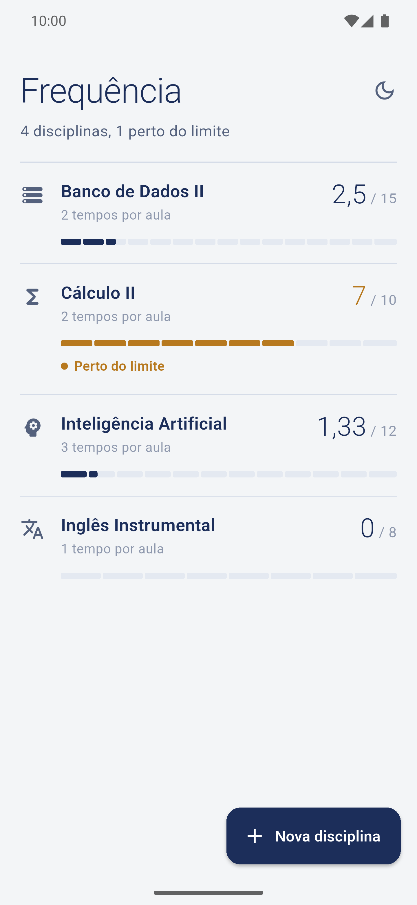
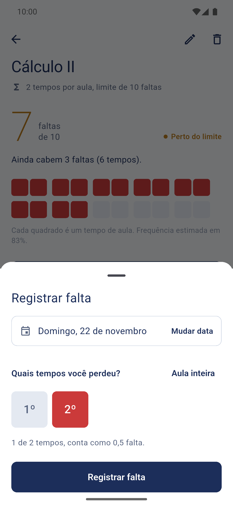

# Frequência

App Android pra controlar faltas da faculdade. Fiz porque lá a chamada é por tempo de aula e não por dia: se a matéria tem dois tempos e eu saio depois do primeiro, levo meia falta. Os apps de frequência que testei só contavam falta inteira, então eu acabava fazendo a conta de cabeça e errando.

Funciona offline e não tem login. Os dados ficam só no celular.

<p align="center">
  
  
  
</p>

## O que ele faz

Você cadastra cada disciplina com quantos tempos ela tem por aula (1, 2, 3 ou outro número) e o limite de faltas do semestre. Quando faltar, abre a disciplina, toca em "Registrar falta" e marca quais tempos perdeu. Por padrão já vem a aula inteira marcada, que é o caso mais comum.

A falta é calculada assim: tempos perdidos dividido por tempos por aula. Numa matéria de 2 tempos, perder um conta 0,5 falta. Numa de 3 tempos, perder um conta 0,33. O app guarda os tempos e não a falta arredondada, então a soma nunca se perde.

Na tela da disciplina aparece uma grade com um quadrado por tempo que você pode faltar até chegar no limite, agrupados por aula. O que já foi usado fica vermelho. Quando passa de 70% do limite a disciplina fica amarela na lista, e quando estoura fica vermelha.

O ícone da disciplina é sugerido pelo nome enquanto você digita (Banco de Dados vira um ícone de banco, Cálculo vira um somatório etc.), mas dá pra trocar. Tem tema claro e escuro.

## Instalar

Baixe o `app-release.apk` na página de [releases](https://github.com/LuGoAn/frequencia-app/releases) direto pelo celular e abra. O Android vai pedir pra liberar a instalação de fontes desconhecidas.

## Rodar o projeto

Precisa do Flutter 3.47 ou mais novo.

```bash
flutter pub get
flutter run
```

Os testes cobrem o cálculo das faltas e um fluxo de cadastro:

```bash
flutter test
```

## Como está organizado

```text
lib/
├── models/      disciplina e registro de falta
├── services/    cálculo das faltas, sugestão de ícone e armazenamento
├── state/       estado do app (ChangeNotifier)
├── screens/     lista, detalhe e cadastro de disciplina
├── widgets/     grade de tempos, linha da lista e os bottom sheets
└── theme/       cores e tema
```

Os dados são salvos em JSON com `shared_preferences`. As datas usam `intl` em pt-BR.

As disciplinas e faltas que aparecem nas capturas de tela são de exemplo.
