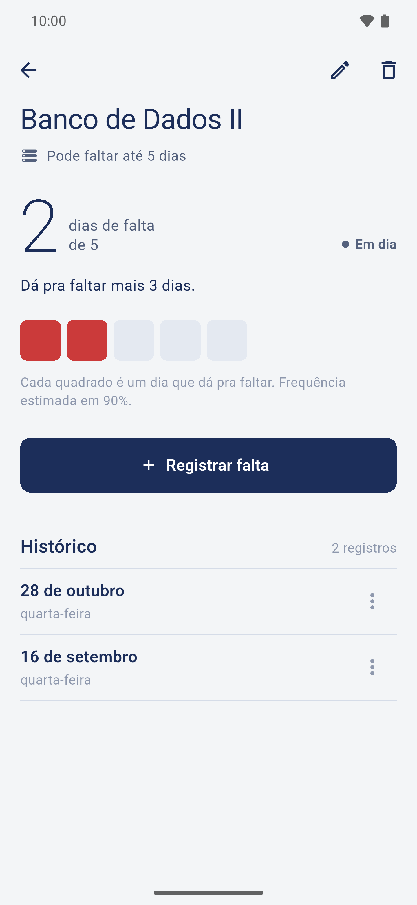

# Frequência

App Android pra controlar faltas da faculdade. Fiz porque eu vivia fazendo conta de cabeça pra saber quantos dias ainda podia faltar em cada matéria, e às vezes errava.

Funciona offline e não tem login. Os dados ficam só no celular.

<p align="center">
  
  
  
</p>

## O que ele faz

Você cadastra cada disciplina com quantos dias pode faltar no semestre. Quando faltar, toca no +1 da disciplina na lista e a falta de hoje já fica registrada. Se for de outro dia, abre a disciplina e usa "Registrar falta", que deixa escolher a data. Na tela da disciplina aparece um quadrado por dia que dá pra faltar, e os que já foram usados ficam vermelhos. Quando passa de 70% do limite a disciplina fica amarela na lista, e quando estoura fica vermelha.

Na minha faculdade o sistema mostra o limite em faltas por tempo de aula: Banco de Dados aparece como 0/15, mas como são 3 tempos por dia, na prática são 5 dias. Se for o seu caso, no cadastro tem um "Não sabe quantos dias?" que faz essa conta.

O ícone da disciplina é sugerido pelo nome enquanto você digita (Banco de Dados vira um ícone de banco, Anatomia vira um boneco, Direito Civil vira um martelo etc.), mas dá pra trocar. Tem ícone pra computação, engenharia, saúde, direito, negócios, artes e humanas. Tem tema claro e escuro.

## Instalar

Baixe o `frequencia-x.y.z.apk` da última versão na página de [releases](https://github.com/LuGoAn/frequencia-app/releases) direto pelo celular e abra. O Android vai pedir pra liberar a instalação de fontes desconhecidas.

## Rodar o projeto

Precisa do Flutter 3.47 ou mais novo.

```bash
flutter pub get
flutter run
```

Os testes cobrem o cálculo das faltas, a sugestão de ícone e o fluxo de cadastro:

```bash
flutter test
```

## Como está organizado

```text
lib/
├── models/      disciplina e registro de falta
├── services/    cálculo das faltas, sugestão de ícone e armazenamento
├── state/       estado do app (ChangeNotifier)
├── screens/     lista, detalhe e cadastro de disciplina
├── widgets/     grade de faltas, linha da lista, sheets e o diálogo de dias
└── theme/       cores e tema
```

Os dados são salvos em JSON com `shared_preferences`. As datas usam `intl` em pt-BR.

As disciplinas e faltas que aparecem nas capturas de tela são de exemplo.
