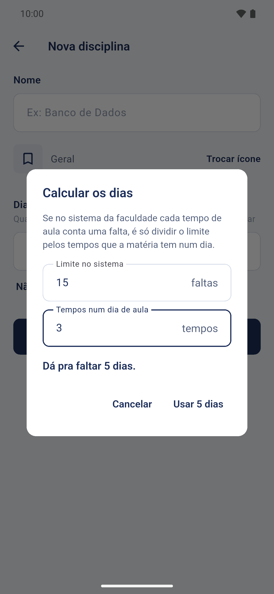

# Frequência

App Android pra controlar faltas da faculdade. Fiz porque eu vivia fazendo conta de cabeça pra saber quantos dias ainda podia faltar em cada matéria, e às vezes errava.

No meu caso, Banco de Dados deixa faltar 5 dias no semestre. Se eu falto hoje, abro o app, toco no +1 do lado da matéria e ela passa pra 1 de 5, com o aviso de que ainda dá pra faltar mais 4 dias. Quando chega perto do limite a matéria fica amarela na lista, e quando estoura fica vermelha.

<p align="center">
  
  
  
</p>

Se a falta foi em outro dia, dá pra abrir a matéria e escolher a data. Lá dentro aparece um quadrado por dia que dá pra faltar, e os usados ficam vermelhos.

O sistema da minha faculdade mostra o limite em faltas por tempo de aula: Banco de Dados aparece como 0/15, mas como são 3 tempos por dia, na prática são 5 dias. Pra quem tem o mesmo problema, o cadastro tem um "Não sabe quantos dias?" que faz essa conta.

O app funciona offline, sem login, e os dados ficam só no celular. A única coisa que usa internet é a checagem de versão nova: quando sai uma release aqui no GitHub, aparece um aviso com o link pro APK.

## Instalar

Baixe o `frequencia-x.y.z.apk` da última versão na página de [releases](https://github.com/LuGoAn/frequencia-app/releases) direto pelo celular e abra. O Android vai pedir pra liberar a instalação de fontes desconhecidas.

## Rodar o projeto

Precisa do Flutter 3.47 ou mais novo.

```bash
flutter pub get
flutter run
flutter test
```

Os dados ficam salvos em JSON no `shared_preferences`.
